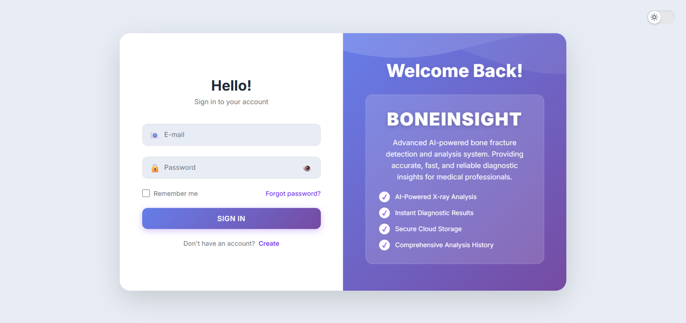
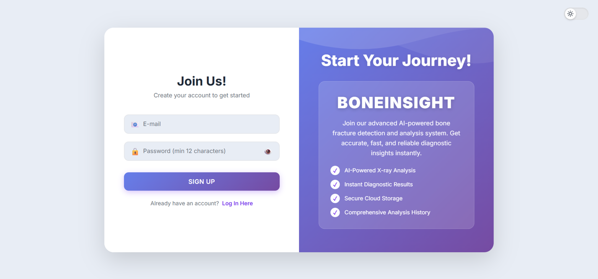
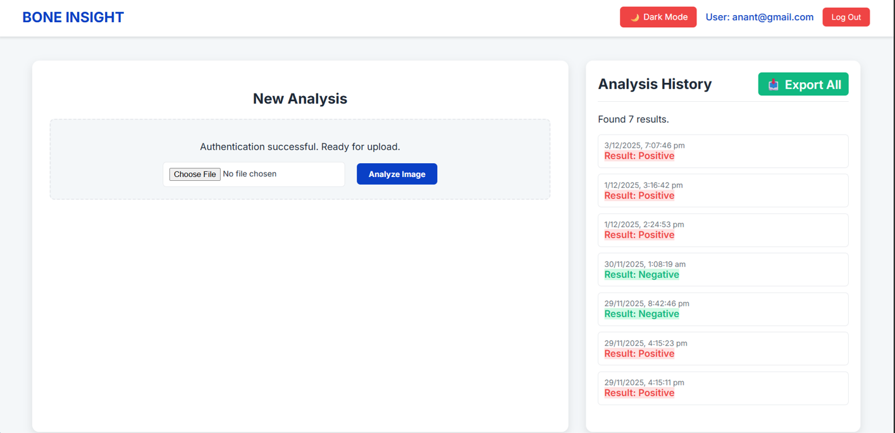
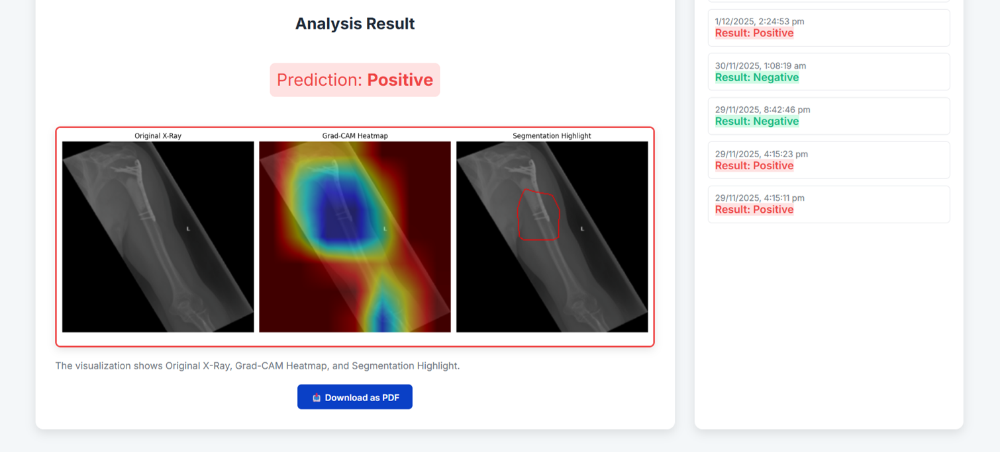

# 🦴 BoneInsight

**BoneInsight** is a deep learning project that detects and localizes musculoskeletal abnormalities from radiographs using the **MURA dataset**.  
It uses **DenseNet121** for classification and **Grad-CAM** for explainable visualization of affected regions.

---
## 🖥️Screenshots

## 🖥️Screenshots

   

## 🔍 Overview

BoneInsight classifies whether a patient’s radiograph shows any abnormality and highlights the affected region using Grad-CAM-based heatmaps.  
This project is part of ongoing medical AI research aimed at improving explainable diagnosis from X-rays.

---

## ⚙️ Features

- 🧠 **DenseNet121** backbone trained on the MURA dataset  
- 🔥 **Grad-CAM visualization** for explainable AI-based segmentation  
- 🖥️ **Simple GUI interface** for easy use  
- 📈 **Trained model** (`mura_densenet121.pth`) ready for inference  
- 🧩 **Future work:** Grad-CAM++, Vision Transformers, and advanced segmentation

## 🔒Research Notice

The full training and preprocessing code are withheld due to ongoing research and publication plans. Contact the author (anantvishwakarma34@gmail.com) for the full source code.
